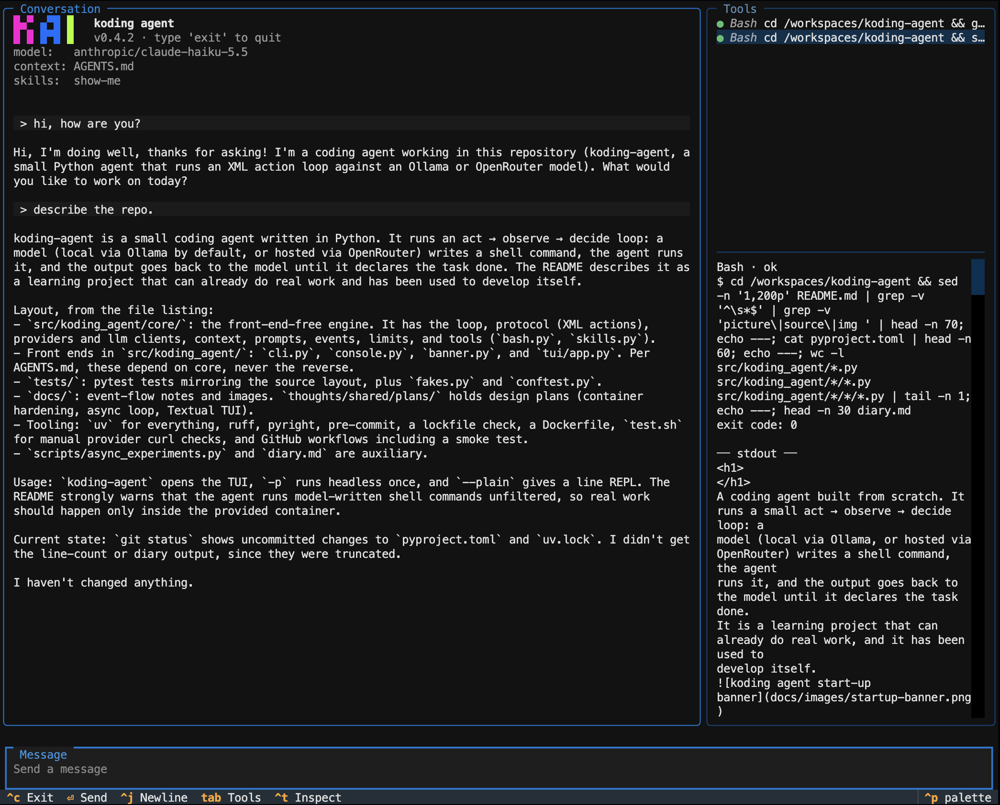

<h1>
  <picture>
    <source media="(prefers-color-scheme: dark)" srcset="docs/images/headline-dark.svg">
    
  </picture>
</h1>

A coding agent built from scratch. It runs a small act → observe → decide loop: a
model (local via Ollama, or hosted via OpenRouter) writes a shell command, the agent
runs it, and the output goes back to the model until it declares the task done.

It is a learning project that can already do real work, and it has been used to
develop itself.



> [!CAUTION]
> **The agent runs model-written shell commands with no filtering.** A wrong or
> malicious command can delete files, read credentials or exfiltrate data. Use it
> for real work **only inside the container** described in
> [Running in a container](#running-in-a-container), on a throwaway clone of your
> repository. The host quick start below is for trying things out.

## Quick start

You need [uv](https://docs.astral.sh/uv/) and either Ollama running locally or an
OpenRouter API key. uv fetches the Python version the project requires.

```sh
# Run straight from GitHub (no clone needed)
uvx --from git+https://github.com/kaijennissen/koding-agent koding-agent --version

# Or from a clone
git clone https://github.com/kaijennissen/koding-agent && cd koding-agent
uv sync
uv run koding-agent -p "list the files in this repo" -t 10
```

Start a model first if you use Ollama (the default):

```sh
ollama serve &
ollama pull qwen3.8:27b-mlx
```

Then pick a mode:

```sh
koding-agent                    # terminal UI (default)
koding-agent "fix the bug"      # TUI, with this as the first message
koding-agent -p "fix the bug"   # headless: run once, print the answer
koding-agent --plain            # line-based REPL
```

Keep the first runs small with `-t/--max-turns`, and read the diff afterwards.

## Usage

- **TUI:** conversation on the left, live tool calls on the right (yellow = running,
  green = exit 0, red = failed or timed out, grey = cancelled). `Enter` sends,
  `Ctrl+J` adds a newline, `Tab` shows or hides the tools panel, `Ctrl+C` quits.
  `Ctrl+N` starts a new session and keeps your typed draft (`/new`, alias `/clear`,
  does the same). While a turn runs, `Enter` is refused. If the model can't be reached, the error is
  shown and the turn is dropped from history, so you can send again.
- **Headless (`-p`):** no terminal needed. Progress goes to stdout, then the answer.
  A model failure exits non-zero. Good for scripts and CI.
- **`--plain`:** the original REPL. Type `exit` to leave.

The TUI needs an interactive terminal on stdin and stdout. Without one (pipe, cron,
`docker run` without `-t`) it exits with a hint; use `-p` there.

| Flag | Meaning |
| --- | --- |
| `-t/--max-turns N` | turn budget for a run (all modes) |
| `--command-timeout S` | timeout per shell command (default 120) |
| `--provider {ollama,openrouter}` | model backend (default `ollama`) |
| `-m/--model` | model name (Ollama has a default; OpenRouter requires one) |
| `--base-url` | provider endpoint |
| `--timeout S` | seconds per model request (default 120) |
| `--no-context` | do not load `AGENTS.md` project context |
| `--skills-dir DIR`, `--no-skills` | load skills from a directory, or none |

Run `koding-agent --help` for the full list. Combining `-p`, `--plain` and a
positional prompt is an error.

## How it works

Every model reply is a single action, either a batch of bash commands or one
exit with the final answer:

```xml
<action>
  <bash>ls src</bash>
  <bash>wc -l src/*.py</bash>
</action>
```

The agent runs the batched commands, returns their output to the model, and repeats.
A reply that mixes a bash command with an exit is rejected with an error the model sees.

The loop is bounded so a runaway turn can't run forever or flood the context:

- a turn budget (`--max-turns`),
- a timeout per command (`--command-timeout`),
- truncated output (first 2000 characters of stdout and of stderr).

Project context comes from an `AGENTS.md` in the working directory, and skills come
from `.agents/skills/`.

## Providers

Choose the backend with `--provider`. Flags you leave out fall back to the provider's
defaults. All modes work with every provider.

| Provider | Default model | Key | Endpoint |
| --- | --- | --- | --- |
| `ollama` (default) | `qwen3.8:27b-mlx` | none | `--base-url`, then `$OLLAMA_HOST`, then `http://localhost:11434` |
| `openrouter` | none, `--model` required | `OPENROUTER_API_KEY` (or `--api-key-env`) | OpenRouter API |

```sh
uv run koding-agent --model <other-model> --plain
uv run koding-agent --base-url http://other-host:11434 -p "..."
export OPENROUTER_API_KEY=sk-or-...   # read from the environment, never from a file
uv run koding-agent --provider openrouter --model <vendor/model-id> -p "..."
```

A missing model, missing key or unknown provider fails immediately with a message.
Any API key you export is visible to every command the agent runs, so use a key with
a spending limit.

## Running in a container

This is the recommended setup. The container runs as a non-root user, with a read-only
root filesystem, all capabilities dropped and resource limits. The agent works on an
independent clone mounted at `/workspace`, and the harness code is a read-only copy in
the image. Your working tree is never touched.

```sh
# 1. Build the image from this repository.
docker build --tag agent_sandbox --file Dockerfile .

# 2. Create a fresh clone of the target repository (URL or local path).
WORKSPACE=/tmp/agent-workspace
rm -rf "$WORKSPACE"
git clone --no-hardlinks "$REPO" "$WORKSPACE"   # REPO=. to work on this repository

# 3. Run one agent invocation against the clone.
docker run --rm -it \
    --read-only --tmpfs /tmp:size=64m \
    --cap-drop ALL --security-opt no-new-privileges \
    --pids-limit 100 --memory 4g --cpus 2 \
    --add-host=host.docker.internal:host-gateway \
    --volume "$WORKSPACE":/workspace \
    agent_sandbox \
    /opt/app/bin/koding-agent --max-turns 25 --prompt "..."

# 4. Review the changes on the host before you push anything.
git -C "$WORKSPACE" status
git -C "$WORKSPACE" diff
```

Notes:

- Omit `--prompt` for the TUI (keep `-it`), add `--plain` for the REPL, or omit the
  trailing command for a shell inside the same container.
- The image has Python, `uv`, Node.js (for pyright), `git`, `curl`, `jq` and `vim`.
  Inside the container, `uv run pytest`, `uv run ruff check`, `uv run pyright` and
  `uv run pre-commit run` work in `/workspace`. uv creates `/workspace/.venv` on first
  use, which needs network access to PyPI. Caches live under `/workspace` because
  `/tmp` is small and `noexec`.
- Other toolchains need to be added to the `Dockerfile`. The agent cannot install
  system packages.
- The container still has network access, so it can reach Ollama on the host. Docker
  narrows the blast radius, but it is not a perfect sandbox.
- Only clone repositories you are willing to let the agent modify. Don't put
  credentials (SSH keys, tokens, `.env` files) into the clone.
- On a Linux host the clone must be writable by UID 1000 (the container's `agent` user).

## Architecture

```text
src/koding_agent/
  core/             # the agent; knows nothing about any front end
    __init__.py     # curated public API (re-exports only)
    loop.py         # run_agent and turn orchestration
    context.py      # AGENTS.md project context
    prompts.py      # system prompt templates and construction
    protocol.py     # action parsing and protocol errors
    events.py       # event types, emission and tool lifecycle
    llm.py          # message/call types and LlmError
    providers.py    # model providers (Ollama, OpenRouter), config and registry
    limits.py       # timeout and output limits shared by prompts and Bash tool
    tools/          # bash.py, skills.py
  console.py        # CLI event printing and terminal colours
  banner.py
  cli.py            # argument parsing and mode selection
  tui/              # Textual terminal UI
```

The front ends (`cli`, `console`, `tui`) depend on `koding_agent.core`. Core does not
import them, so the agent loop can be reused from any interface. Inside core, modules
import each other directly rather than through the `__init__` facade.

## Development

Development uses uv. `uv sync` creates the environment. Without configuration the
agent reaches Ollama at `http://localhost:11434`. Inside the container,
`OLLAMA_HOST` points at the host instead, so develop there too.

```sh
uv run pytest           # tests
uv run ruff check .     # lint
uv run ruff format .    # format
uv run pyright          # type-check (strict)
uv run pre-commit run   # everything pre-commit runs
```

`./test.sh ollama` and `./test.sh openrouter` send a one-line request to each provider
with `curl`, to check the endpoint and key outside the agent. Pre-commit runs ruff,
pyright and a lockfile check, and CI runs lint and tests on every push. See
[AGENTS.md](AGENTS.md) for conventions when working on this repository with a coding
agent.

## How it was built

The project grew in steps, and the repository records them:

- [`diary.md`](diary.md) logs pitfalls and design decisions, one entry per topic,
  newest at the bottom. Start here for the reasoning behind `shell=True`, the regex
  parsing and similar choices.
- [`thoughts/shared/`](thoughts/shared/) holds the design notes: the hardened container
  (`001`), the async loop (`003`) and the Textual TUI (`004`).
- [`docs/event-flow.md`](docs/event-flow.md) describes how events move from the loop
  to the front ends.
- Most features, including parallel tool calls, were implemented by the agent working
  on its own repository, with a human reviewing the diffs.

Bash-only is a deliberate choice. In
[*An Empirical Study of Harness Design for Coding Agents*](https://arxiv.org/abs/2609.20804)
(Fan et al., 2026), models with good shell skills did as well or better with a
bash-only action space than with dedicated file, search and edit tools, at lower cost.
Weaker models did worse without structured tools, and the study did not evaluate the
model used here, so the benefit depends on the model.

## Status and roadmap

**Works today:** the XML action loop, TUI / headless / REPL modes, batched tool calls,
two providers, bounded runs, skills, `AGENTS.md` context, and the container setup.

**Known limits:**

- Two model backends (Ollama, OpenRouter).
- No dedicated file-edit tool. Bash covers editing.
- No persistence between sessions.
- The container has network access, so it is not a perfect sandbox.

Review the agent's diff before you commit or publish anything.

## Contributing

Read [AGENTS.md](AGENTS.md) first. It covers the commands, conventions and the rule
that agent runs happen only in a container.
