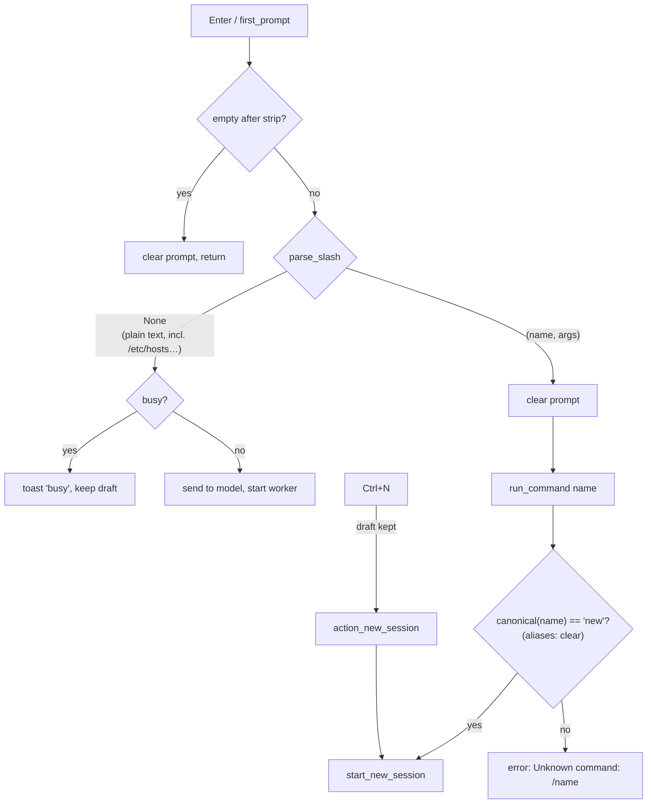
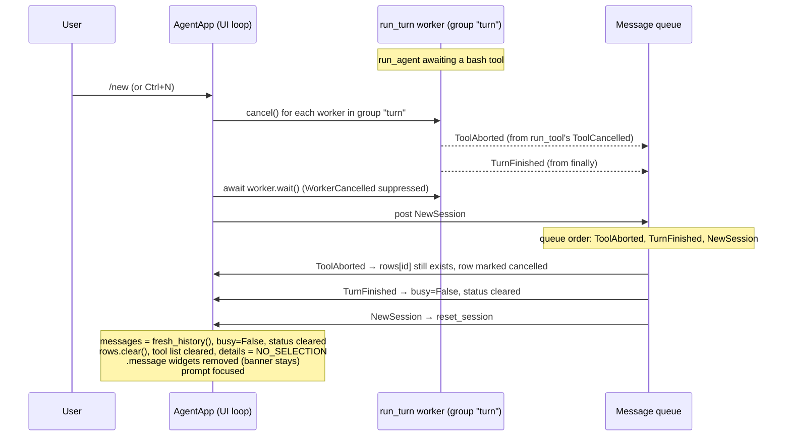

# Notes: `/new` session flow

`run_tool` emits `ToolCancelled` when its task is cancelled, so cancelling a turn
leaves events behind in the message queue. The reset has to run after them.

## 1. Submit routing



Commands are dispatched before the busy check, so they work mid-turn. `args` is
parsed but not passed on yet.

## 2. `/new` while a tool runs



## 3. Why `NewSession`

```diff
 start_new_session
   cancel workers in group "turn"
   await worker.wait()
-  reset_session()                         # runs now, leftovers still queued
+  post_message(NewSession)                # reset runs after the leftovers
 ...
 queue: ToolAborted
-  on_tool_aborted → self.rows[id]  → KeyError (row already cleared)
+  on_tool_aborted → row still present → fine
```

## Edge cases

- **Cancel during the model call:** `run_tool` isn't active, so no `ToolAborted`;
  only `TurnFinished` is posted. The reset works the same way.
- **Cancel before the worker's first step:** the worker never runs its `try`/`finally`,
  so no `TurnFinished` is posted at all. That is why `reset_session` itself sets
  `busy=False` and clears the status. `run_turn` is passed to `run_worker` as a
  callable (not `run_turn()`), so a worker cancelled before it starts leaves no
  never-awaited coroutine behind.

## Plain REPL

No concurrency, so none of the above applies. `/new` (alias `/clear`) just rebinds
`messages = start_session()`, which prints the banner. Unknown commands are printed
in red and not sent. Both share `parse_slash` and `canonical` from `commands.py`.

## Later

- **#84 `/model`:** needs `args` passed through `run_command`, plus an idle-only
  guard there.
- **#85:** commands are dispatched before the busy check, so they are never queued
  as steering messages.
